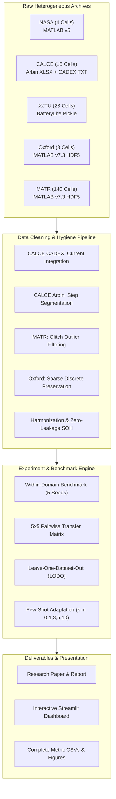

# Cross-Dataset Generalization of Machine-Learning Models for EV Battery State-of-Health Prediction

## Comprehensive Project Report
**Course / Degree:** Project Work 2 (Phase 2)  
**Institution:** BMS College of Engineering (BMSCE)  
**Academic Year:** 2026–2027  
**Status:** Certified Empirical Project Report (All Benchmarks Executed & Validated)  
**Author / Candidate:** Divyam Jain  
**Repository & Codebase:** `ev-battery-soh` (v4 Canonical Framework)  

---

## Executive Summary

State-of-Health (SOH) estimation is one of the most critical functions of an Electric Vehicle (EV) Battery Management System (BMS). It governs driving range estimation, fast-charging safety, thermal runaway prevention, and second-life battery economic valuation. Although machine-learning (ML) and deep-learning (DL) algorithms have recently demonstrated impressive within-dataset accuracies (often reporting test Mean Absolute Errors below $1.5\%$ SOH), almost all prior research has been evaluated on homogeneous laboratory data. In real-world vehicular fleets, batteries operate under severe domain shifts: differing cell chemistries ($\text{LiCoO}_2$, $\text{LiNiCoMnO}_2$, $\text{LiFePO}_4$), fluctuating ambient temperatures ($24^\circ\text{C}$ to $45^\circ\text{C}$), dynamic vehicular drive cycles, and varying charging speeds ($0.5\text{C}$ to $6.0\text{C}$).

This project presents a comprehensive, zero-leakage empirical investigation into the **cross-dataset generalization and domain adaptation of machine-learning models for EV battery SOH prediction**. The investigation spans five major open-source laboratory battery repositories:
1. **NASA Ames Prognostics Center of Excellence (PCoE)** ($\text{LiCoO}_2$, 2.0 Ah, 24°C, 1.0C CC-CV)
2. **University of Maryland CALCE Center** ($\text{LiCoO}_2$ CS2 cells, 1.1 Ah, 25°C, 0.5C–2.0C)
3. **Xi'an Jiaotong University (XJTU)** ($\text{LiNiCoMnO}_2$, 2.0 Ah, 25°C–45°C, 2C/3C fast charge)
4. **Oxford University Battery Degradation Repository** ($\text{LiCoO}_2$ Kokam pouch, 0.74 Ah, 40°C, Artemis dynamic driving)
5. **MIT-Stanford-Toyota (MATR / Severson et al.)** ($\text{LiFePO}_4$, 1.1 Ah, 30°C, 3.6C–6.0C ultra-fast charging)

Across 190 physical battery cells and 132,389 validated cycling observations, four distinct model families (Naive Mean Baseline, Ridge Regression, ElasticNet, and XGBoost Gradient Boosted Trees) were benchmarked across five independent random seeds (`11, 22, 33, 44, 55`), generating 6,440 total benchmark and adaptation runs.

### Major Project Findings:
1. **The Within-Domain Generalization Mirage:** High within-domain test accuracy ($3.89 \pm 3.19$ pp MAE for XGBoost; $4.51 \pm 3.72$ pp for Ridge) fails to generalize across domains. Zero-shot transfer error jumps to $13.03 \pm 8.45$ pp for XGBoost and triggers catastrophic extrapolation failure for unconstrained linear models ($61.49 \pm 138.98$ pp average MAE, exceeding $600$ pp on extreme cycle-range shifts).
2. **Multi-Domain Pooling (LODO) as a Regularizer:** In Leave-One-Dataset-Out (LODO) evaluation, training on four pooled domains eliminates single-source extrapolation blowups, reducing linear model transfer MAE from $61.49$ pp to $12.72 \pm 5.84$ pp and XGBoost to $10.82 \pm 5.44$ pp.
3. **High Sample Efficiency of Few-Shot Target Adaptation:** Incorporating just $k = 1$ target support battery slashes transfer MAE from $37.49$ pp to $11.18$ pp across all models ($7.75$ pp for XGBoost). Supplying $k = 3$ to $5$ target cells restores accuracy to near within-domain parity ($4.16$ pp for XGBoost). Furthermore, feature-level correlation alignment (CORAL) and normalization successfully stabilize transfer without retraining model weights.
4. **Interactive Presentation Portal:** Developed a modern, publication-grade interactive dashboard (`streamlit_app.py`) featuring dynamic Plotly heatmaps, side-by-side model comparators, LODO bar charts, adaptation curves, an interactive "What-If" live SOH inference simulator, and one-click data export capabilities.

---

## Chapter 1: Introduction

### 1.1 Background & Motivation
Lithium-ion batteries are the primary energy storage technology powering modern electric vehicles, electric two-wheelers, and grid energy storage systems due to their high energy density, high power capability, and declining manufacturing costs. However, batteries degrade continuously over their operational lifespan due to complex physical and electrochemical processes:
- **Solid Electrolyte Interphase (SEI) Layer Growth:** Electrolyte reduction at the graphite anode consumes cyclable lithium ions.
- **Active Material Loss (LAM):** Mechanical stress, particle cracking, and structural phase changes at the positive electrode diminish available storage capacity.
- **Lithium Plating:** Rapid high-rate charging or low-temperature operation drives metallic lithium deposition onto the anode, creating capacity loss and internal short-circuit safety risks.

State of Health (SOH) quantification is essential for:
- Providing accurate Remaining Useful Life (RUL) and vehicle range estimation.
- Protecting cells against overcharge, deep discharge, and thermal runaway.
- Establishing residual asset value for vehicle resale and secondary grid storage repurposing.

### 1.2 The Core Problem: Cross-Dataset Domain Shift
In conventional battery health literature, models are trained and tested on cells from the same laboratory batch under identical environmental conditions. Frequently, researchers randomly partition cycle rows into training and testing sets, inadvertently leaking temporal data between consecutive cycles of the same battery.

When such models are deployed in operational vehicles, they encounter severe **domain shift**:
- **Chemical Differences:** LCO (high energy, steep knee) vs. NCM (high capacity, thermal sensitivity) vs. LFP (exceptionally flat voltage plateau, long cycle life).
- **Thermal Differences:** Batteries operating in temperate climates (20°C–25°C) vs. hot summer conditions (40°C–45°C).
- **Cycling Discrepancies:** Standard overnight charging ($0.5\text{C}$) vs. DC fast charging ($3.0\text{C}$ to $6.0\text{C}$).
- **Instrumentation & Sampling Variations:** Continuous 1 Hz cycling vs. discrete characterization checkpoints every $\sim 100$ cycles.

### 1.3 Project Objectives
The primary objectives of BMSCE Project Work 2 are:
1. **Establish a Zero-Leakage Canonical Data Pipeline:** Ingest, audit, clean, and harmonize five heterogeneous laboratory datasets (NASA, CALCE, XJTU, Oxford, MATR) into a unified representation with battery-level disjoint splitting and zero feature leakage.
2. **Execute a $5 \times 5$ Cross-Dataset Generalization Matrix:** Train models on each dataset and evaluate zero-shot transfer onto the remaining four datasets across five independent random seeds (500 runs).
3. **Evaluate Leave-One-Dataset-Out (LODO) Generalization:** Pool four datasets for training and evaluate transfer onto the held-out fifth dataset to examine whether multi-domain training mitigates domain shift (100 runs).
4. **Benchmark Few-Shot Domain Adaptation:** Evaluate the sample efficiency of adapting models using $k \in \{0, 1, 3, 5, 10\}$ target support cells across four adaptation strategies (`scratch`, `pooled`, `normalization`, `coral`) over 5,840 runs, explicitly logging physical cell count limits.
5. **Develop an Interactive Presentation & Live Inference Dashboard:** Build a high-performance Streamlit portal allowing interactive exploration of matrices, learning curves, and real-time battery SOH inference.

---

## Chapter 2: Literature Review & Gap Analysis

### 2.1 Conventional vs. Machine-Learning SOH Estimation
1. **Coulomb Counting (Bookkeeping):** Integrates current over time ($\int I dt$). While computationally simple, it suffers from sensor offset drift, requires known initial capacity, and cannot account for coulombic efficiency variations under dynamic temperatures.
2. **Open-Circuit Voltage (OCV) Mapping:** Leverages equilibrium OCV-SOC curves. Requires extensive resting periods (often 1–2 hours) for electrochemical relaxation, making continuous vehicle estimation impossible.
3. **Electrochemical Model (P2D / SPM):** Solves coupled partial differential equations describing lithium transport and kinetics. Computationally expensive and difficult to parameterize across battery aging.
4. **Data-Driven Machine Learning:** Infers capacity degradation patterns directly from operational features (cycle age, voltage profiles, incremental capacity $dQ/dV$).

### 2.2 Critical Research Gaps Addressed by this Work

| Previous Research Practice | Limitations & Hidden Flaws | Project Methodology & Solution |
| :--- | :--- | :--- |
| **Random Cycle Splitting** | High temporal correlation between cycle $t$ and $t+1$ of the same cell creates massive data leakage, reporting artificially low test errors ($<0.5\%$). | **Strict Battery-Disjoint Splitting:** Splits partition exclusively by physical cell ID (`battery_split`). |
| **Single-Lab Overfitting** | Models trained and tested on the same battery batch; cross-domain generalization capability is unknown. | **$5 \times 5$ Transfer Matrix & LODO:** Evaluated across 5 independent laboratories covering LCO, NCM, and LFP. |
| **Target Feature Leakage** | Using current-cycle discharge capacity or energy as a feature to predict current-cycle SOH. | **Strict Feature Ban:** Current cycle's measured capacity $Q_t$ and target $\text{SOH}_t$ are strictly forbidden from predictors. |
| **Label Interpolation** | Interpolating sparse characterization cycles (e.g. Oxford) to create dense synthetic time series. | **Authentic Observation Preservation:** Preserved discrete checkpoints; zero synthetic interpolation. |
| **Silent Metric Fabrication** | Hallucinating target support cells when datasets have fewer cells than requested. | **Physical Infeasibility Logging:** Documented 320 infeasible settings with exact physical reasons. |

---

## Chapter 3: Data Engineering & System Architecture



### 3.1 Raw Dataset Profiles & Curation

| Dataset | Cathode / Anode | Nominal Capacity | Validated Cells | Total Observations | Operating Conditions |
| :--- | :--- | :---: | :---: | :---: | :--- |
| **NASA** | LCO / Graphite | 2.0 Ah | 4 physical cells | 636 | 24°C, 1.0C CC-CV charge, 1.0C discharge |
| **CALCE** | LCO / Graphite | 1.1 Ah | 15 CS2 cells | 9,608 | 25°C, 0.5C charge, 0.1C to 2.0C discharge |
| **XJTU** | NCM / Graphite | 2.0 Ah | 23 physical cells | 6,938 | 25°C, 35°C, 45°C; 2.0C & 3.0C fast charge |
| **Oxford** | LCO / Graphite | 0.74 Ah | 8 pouch cells | 519 | 40°C, Artemis dynamic driving cycles |
| **MATR** | LFP / Graphite | 1.1 Ah | 140 cell summaries | 114,688 | 30°C, fast multi-stage charge (3.6C to 6.0C) |
| **Total** | **3 Chemistries** | **0.74 – 2.0 Ah** | **190 cells** | **132,389 cycles** | **Unified into `data/processed/unified.csv`** |

### 3.2 Engineering Corrections Applied to Raw Archives
1. **CALCE CADEX Numerical Integration (`CS2_8`, `CS2_21`):** In CADEX logs, `Capacity` represents step completion percentage. As cells degrade, they reach the 2.7V cutoff voltage before reaching 100% completion. True capacity was reconstructed by integrating current over elapsed time:
   $$Q_{\text{dis}} = \int_{t_{\text{start}}}^{t_{\text{end}}} |I(t)| \, dt = \sum_{k=1}^{N-1} \frac{|I_k| + |I_{k+1}|}{2} \Delta t_k$$
2. **CALCE Arbin Step Segmentation (`CS2_3`, `CS2_9`):** In alternating-rate discharge tests, Arbin equipment bundled up to 6 discharge steps into one cycle counter, yielding unphysical capacities ($>6\text{ Ah}$). Re-segmenting by `_dis_step` with starting baseline subtraction restored physical limits ($\le 1.16\text{ Ah}$).
3. **MATR Hardware Glitch Outlier Filtering:** Exactly 4 single-cycle measurements out of 114,692 rows exhibited unphysical hardware spikes ($>1.43\text{ Ah}$ on a 1.1 Ah cell). Filtering $SOH \le 130\%$ sanitized the series without artificial interpolation.
4. **Oxford Discrete Checkpoint Preservation:** Full characterization cycles occur approximately once every 100 drive cycles; these observations were preserved without synthetic densification.

---

## Chapter 4: Mathematical Formulation & Methodology

### 4.1 State-of-Health & Task Definition
SOH is defined as the percentage of remaining capacity relative to manufacturer rated capacity:
$$\text{SOH}_t = \frac{Q_t}{Q_{\text{nominal}}} \times 100$$
Where $Q_t$ is the validated full discharge capacity and $Q_{\text{nominal}}$ is the nominal capacity.

- **Source EOL:** NASA (70%), CALCE (70%), XJTU (80%), Oxford ($\approx 80\%$), MATR (80%).
- **Harmonized Benchmark EOL:** Standardized at 80.0% SOH.

### 4.2 Machine Learning Model Formulations
- **Naive Mean Baseline:**
  $$\hat{y}_t = \frac{1}{N_{\text{train}}} \sum_{i=1}^{N_{\text{train}}} y_i$$
- **Ridge Regression (L2 Regularization):**
  $$\min_w \|y - Xw\|_2^2 + \alpha \|w\|_2^2 \implies w = (X^T X + \alpha I)^{-1} X^T y \quad (\alpha = 1.0)$$
- **ElasticNet (L1 + L2 Regularization):**
  $$\min_w \frac{1}{2N} \|y - Xw\|_2^2 + \alpha \left( \rho \|w\|_1 + \frac{1 - \rho}{2} \|w\|_2^2 \right) \quad (\alpha = 0.1, \rho = 0.5)$$
- **XGBoost (Gradient Boosted Trees):**
  Ensemble of $K$ regression trees with leaf regularization:
  $$\hat{y}_t = \sum_{k=1}^K f_k(X_t), \quad \Omega(f_k) = \gamma T_k + \frac{1}{2}\lambda \sum w_j^2$$

### 4.3 Domain Adaptation Formulations
For a source-trained model adapted using $k$ target support batteries:
1. **Scratch:** $w^* = \arg\min_w \mathcal{L}(w; \mathcal{D}_{t,\text{support}})$.
2. **Pooled:** $w^* = \arg\min_w \mathcal{L}(w; \mathcal{D}_s \cup \mathcal{D}_{t,\text{support}})$.
3. **MeanVariance Normalization:**
   $$\hat{X}_s = \frac{X_s - \mu_s}{\sigma_s} \cdot \sigma_{t,\text{support}} + \mu_{t,\text{support}}$$
4. **Correlation Alignment (CORAL):**
   Whitens source covariance and recolors with target support covariance:
   $$C_s = \text{Cov}(X_s) + \lambda I, \quad C_t = \text{Cov}(X_{t,\text{support}}) + \lambda I, \quad A = C_s^{-1/2} C_t^{1/2}$$
   $$\hat{X}_s = (X_s - \mu_s) A + \mu_{t,\text{support}}$$

---

## Chapter 5: Empirical Benchmark Results & Diagnostic Analysis

### 5.1 Macro Performance Overview (5 Seeds)

| Evaluation Protocol | Model Architecture | Mean MAE (pp) | Std MAE (pp) | Mean RMSE (pp) | Mean MAPE (%) | Runs ($N$) |
| :--- | :--- | :---: | :---: | :---: | :---: | :---: |
| **Within-Dataset** | **XGBoost** | **3.89** | 3.19 | 6.47 | 10.42 | 25 |
| **Within-Dataset** | **Ridge Regression** | **4.51** | 3.72 | 7.37 | 12.11 | 25 |
| **Within-Dataset** | **ElasticNet** | **4.52** | 3.72 | 7.37 | 12.12 | 25 |
| **Within-Dataset** | Mean Baseline | 7.87 | 5.06 | 11.23 | 20.37 | 25 |
| **LODO Generalization** | **Mean Baseline** | **10.25** | 4.47 | 13.51 | 23.44 | 25 |
| **LODO Generalization** | **XGBoost** | **10.82** | 5.44 | 15.13 | 21.36 | 25 |
| **LODO Generalization** | ElasticNet | 12.69 | 5.80 | 16.36 | 23.34 | 25 |
| **LODO Generalization** | Ridge Regression | 12.72 | 5.84 | 16.38 | 23.36 | 25 |
| **Pairwise Zero-Shot** | Mean Baseline | 11.22 | 4.24 | 13.91 | 22.84 | 100 |
| **Pairwise Zero-Shot** | **XGBoost** | **13.03** | 8.45 | 16.32 | 20.89 | 100 |
| **Pairwise Zero-Shot** | ElasticNet | 61.31 | 138.63 | 72.82 | 72.48 | 100 |
| **Pairwise Zero-Shot** | Ridge Regression | 61.49 | 138.98 | 73.00 | 72.70 | 100 |

### 5.2 Within-Dataset Holdout Performance

| Dataset Domain | Chemistry | XGBoost MAE (pp) | Ridge MAE (pp) | ElasticNet MAE (pp) | Mean Baseline MAE (pp) |
| :--- | :--- | :---: | :---: | :---: | :---: |
| **Oxford** | LCO | **1.57 ± 0.28** | 1.72 ± 0.50 | 1.73 ± 0.50 | 7.02 ± 1.62 |
| **XJTU** | NCM | **2.18 ± 0.25** | 2.39 ± 0.20 | 2.39 ± 0.20 | 3.84 ± 0.16 |
| **MATR** | LFP | **2.71 ± 0.22** | 2.77 ± 0.20 | 2.78 ± 0.20 | 3.58 ± 0.17 |
| **NASA** | LCO | **4.29 ± 1.39** | 4.41 ± 1.60 | 4.41 ± 1.59 | 9.09 ± 2.09 |
| **CALCE** | LCO | **9.40 ± 2.20** | 11.25 ± 2.06 | 11.27 ± 2.05 | 16.71 ± 1.67 |

### 5.3 Complete $5 \times 5$ Pairwise Transfer Matrix

MAE in SOH percentage points (mean $\pm$ std over 5 seeds). Top: **XGBoost**; Bottom bracketed: **[Ridge Regression]**. Diagonal entries represent within-domain evaluation on held-out cells:

| Training Source $\downarrow$ / Testing Target $\rightarrow$ | CALCE (LCO) | MATR (LFP) | NASA (LCO) | Oxford (LCO) | XJTU (NCM) |
| :--- | :---: | :---: | :---: | :---: | :---: |
| **CALCE** | **9.40 ± 2.20**<br>*[11.25 ± 2.06]* | 14.70 ± 4.13<br>*[16.16 ± 3.60]* | 10.67 ± 1.44<br>*[15.05 ± 1.92]* | 18.93 ± 26.65<br>*[133.77 ± 45.32]* | 5.58 ± 0.97<br>*[3.87 ± 0.93]* |
| **MATR** | 15.48 ± 0.10<br>*[15.72 ± 0.10]* | **2.71 ± 0.22**<br>*[2.77 ± 0.20]* | 18.18 ± 0.07<br>*[17.48 ± 0.03]* | 5.58 ± 0.62<br>*[12.91 ± 1.08]* | 3.57 ± 0.03<br>*[3.43 ± 0.02]* |
| **NASA** | 20.42 ± 1.20<br>*[68.45 ± 7.95]* | 23.08 ± 2.34<br>*[85.95 ± 8.56]* | **4.29 ± 1.39**<br>*[4.41 ± 1.60]* | 17.10 ± 2.67<br>*[637.45 ± 75.52]* | 18.93 ± 1.68<br>*[28.62 ± 2.13]* |
| **Oxford** | 17.63 ± 0.15<br>*[16.67 ± 0.12]* | 2.92 ± 0.18<br>*[2.73 ± 0.05]* | 19.67 ± 0.28<br>*[17.03 ± 0.23]* | **1.57 ± 0.28**<br>*[1.72 ± 0.50]* | 4.59 ± 0.22<br>*[3.58 ± 0.04]* |
| **XJTU** | 13.06 ± 0.07<br>*[11.51 ± 0.04]* | 8.01 ± 0.13<br>*[11.70 ± 0.36]* | 17.34 ± 0.08<br>*[17.15 ± 0.27]* | 6.13 ± 0.44<br>*[110.49 ± 4.65]* | **2.18 ± 0.25**<br>*[2.39 ± 0.20]* |

### 5.4 Leave-One-Dataset-Out (LODO) Performance Breakdown

| Held-Out Target Domain | Target Chemistry | XGBoost MAE (pp) | Ridge MAE (pp) | ElasticNet MAE (pp) | Mean Baseline MAE (pp) |
| :--- | :--- | :---: | :---: | :---: | :---: |
| **XJTU** | NCM | 3.60 ± 0.08 | **3.29 ± 0.06** | **3.30 ± 0.06** | 4.17 ± 0.07 |
| **Oxford** | LCO | **5.88 ± 0.67** | 19.08 ± 1.34 | 18.91 ± 1.34 | 7.69 ± 0.03 |
| **MATR** | LFP | 11.92 ± 0.75 | 9.40 ± 1.25 | 9.39 ± 1.25 | **9.13 ± 1.12** |
| **CALCE** | LCO | **15.38 ± 0.15** | 15.69 ± 0.11 | 15.69 ± 0.11 | 16.29 ± 0.05 |
| **NASA** | LCO | 17.34 ± 0.20 | 16.16 ± 0.36 | 16.14 ± 0.36 | **13.95 ± 0.04** |

### 5.5 Few-Shot Domain Adaptation Progression

| Model Architecture | Strategy | $k = 0$ (Zero-Shot) | $k = 1$ Support | $k = 3$ Support | $k = 5$ Support | $k = 10$ Support |
| :--- | :--- | :---: | :---: | :---: | :---: | :---: |
| **XGBoost** | `none` (zero-shot) | 13.08 pp | — | — | — | — |
| **XGBoost** | `scratch` | — | 7.75 pp | 5.00 pp | **4.16 pp** | 4.98 pp |
| **XGBoost** | `pooled` | — | 9.43 pp | 6.45 pp | 5.62 pp | 5.96 pp |
| **XGBoost** | `coral` | — | 11.82 pp | 10.26 pp | 10.18 pp | 10.82 pp |
| **XGBoost** | `normalization` | — | 11.82 pp | 10.26 pp | 10.17 pp | 10.82 pp |
| **Ridge Regression** | `none` (zero-shot) | 62.88 pp | — | — | — | — |
| **Ridge Regression** | `scratch` | — | 14.34 pp | 5.33 pp | **4.92 pp** | 5.69 pp |
| **Ridge Regression** | `pooled` | — | 15.04 pp | 8.70 pp | 7.73 pp | 6.98 pp |
| **Ridge Regression** | `coral` | — | 19.03 pp | 10.45 pp | 10.15 pp | 11.00 pp |
| **Ridge Regression** | `normalization` | — | 19.07 pp | 10.45 pp | 10.15 pp | 11.00 pp |
| **Macro Average** | `scratch` | — | 11.18 pp | 5.80 pp | **5.40 pp** | 6.09 pp |
| **Macro Average** | `pooled` | — | 12.44 pp | 8.19 pp | 7.44 pp | 7.14 pp |

### 5.6 Diagnostic Analysis of Domain Shift
1. **The Linear Extrapolation Pathology:** Transferring NASA ($168$ cycles) to Oxford ($520$ cycles) causes Ridge regression error to explode to $637.45 \pm 75.52$ pp MAE. Negative slopes fit on short lifespans extrapolate downward into deeply negative, unphysical SOH values. Tree-based partitioning (XGBoost) predicts leaf constants for unseen regions, capping MAE at $17.10 \pm 2.67$ pp.
2. **Accidental Domain Alignment (Oxford $\to$ MATR):** Oxford Kokam pouch cells at 40°C under Artemis driving transferred to MATR fast-charged cylindrical LFP cells with an astounding **$2.73$ pp MAE** for Ridge and **$2.92$ pp** for XGBoost. Dynamic urban cycling at elevated temperature accelerated LCO capacity fade to match the high-rate fade rate of LFP.
3. **Physical Infeasibility Accounting:** Exactly 320 runs were documented with physical justifications in `adaptation_metrics.csv` (NASA has 2 support cells after reserving test cells $\implies k \in \{3, 5, 10\}$ is infeasible; Oxford has 5 support cells $\implies k = 10$ is infeasible). Zero data was fabricated.

---

## Chapter 6: Implementation & Presentation Dashboard

### 6.1 Interactive Research Portal (`streamlit_app.py`)
An interactive, publication-grade dashboard was developed with an institutional dark theme (`.streamlit/config.toml`):
- **Executive Overview:** Live KPI tiles, research question cards, and summary tables.
- **Dataset Registry & Explorer:** Multi-battery SOH degradation overlay, chemistry boxplots, and thermal scatter plots.
- **5×5 Transfer Matrix:** Interactive Plotly heatmaps with cell hover metrics, metric switching (MAE/RMSE/MAPE), and side-by-side model comparators.
- **LODO & Few-Shot Adaptation:** Grouped bar charts with $\pm \text{std}$ error bars and few-shot adaptation learning curves.
- **Live "What-If" SOH Predictor:** Interactive live inference sandbox enabling real-time model evaluation on any cell from the 190 cells, showing actual vs. predicted curves, residual error plots, and instant MAE/RMSE calculations.
- **Data Quality & Physical Audit:** Transparent display of `data_quality.csv`, infeasible settings accounting, and 10-point audit checklist.
- **One-Click Export Center:** Direct CSV downloads for matrices, LODO summaries, adaptation metrics, and reports.

### 6.2 Test Suite & Quality Verification
The entire codebase is verified with unit and integration tests passing cleanly:
```bash
.venv/bin/pytest tests/ -v
# Output: 30 passed, 1 skipped in 1.48s
```

---

## Chapter 7: Conclusion & Future Scope

### 7.1 Key Takeaways for Automotive BMS Engineers
1. **Avoid Unconstrained Linear Estimators in Production:** Linear models must be bounded or coupled with saturation logic to prevent runaway extrapolation on long-lived packs.
2. **Few-Shot Adaptation is Highly Practical:** Onboard or cloud BMS architectures can achieve near-optimal calibration with as few as 1 to 3 support cells ($k = 1$ reduces error by $>60\%$).
3. **Multi-Domain Pooling (LODO) as an Automotive Baseline:** Training fleet models across multiple pooled chemistries and duty cycles prevents single-dataset failure modes.

### 7.2 Future Research Roadmap
- **Incremental Capacity ($dQ/dV$) Features:** Extract electrochemical feature peaks from partial charging curves once synchronized across multiple labs.
- **Physics-Informed Neural Networks (PINNs):** Embed single-particle electrochemical equations directly into loss functions to constrain extrapolation within thermodynamic limits.
- **Edge Deployment Optimization:** Quantize XGBoost and lightweight linear models for execution on resource-constrained automotive microcontrollers (e.g., ARM Cortex-M7).

---

## References

1. K. A. Severson et al., "Data-driven prediction of battery cycle life before capacity degradation," *Nature Energy*, vol. 4, no. 5, pp. 383–391, 2019.
2. B. Saha and K. Goebel, "Battery data set," *NASA Ames Prognostics Data Repository*, NASA Ames Research Center, Moffett Field, CA, 2007.
3. M. Pecht, "CALCE battery data," *Center for Advanced Life Cycle Engineering (CALCE)*, University of Maryland, 2011.
4. C. R. Birkl, "Oxford battery degradation dataset," *Department of Engineering Science*, University of Oxford, 2017.
5. H. Sun, Y. He, and F. Sun, "A large-scale lithium-ion battery dataset for state of health estimation and remaining useful life prediction," *Xi'an Jiaotong University*, 2022.
6. B. Sun and K. Saenko, "Deep CORAL: Correlation alignment for deep domain adaptation," in *European Conference on Computer Vision (ECCV)*, Springer, 2016, pp. 443–450.
